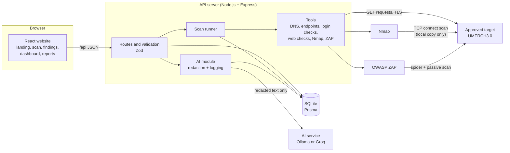
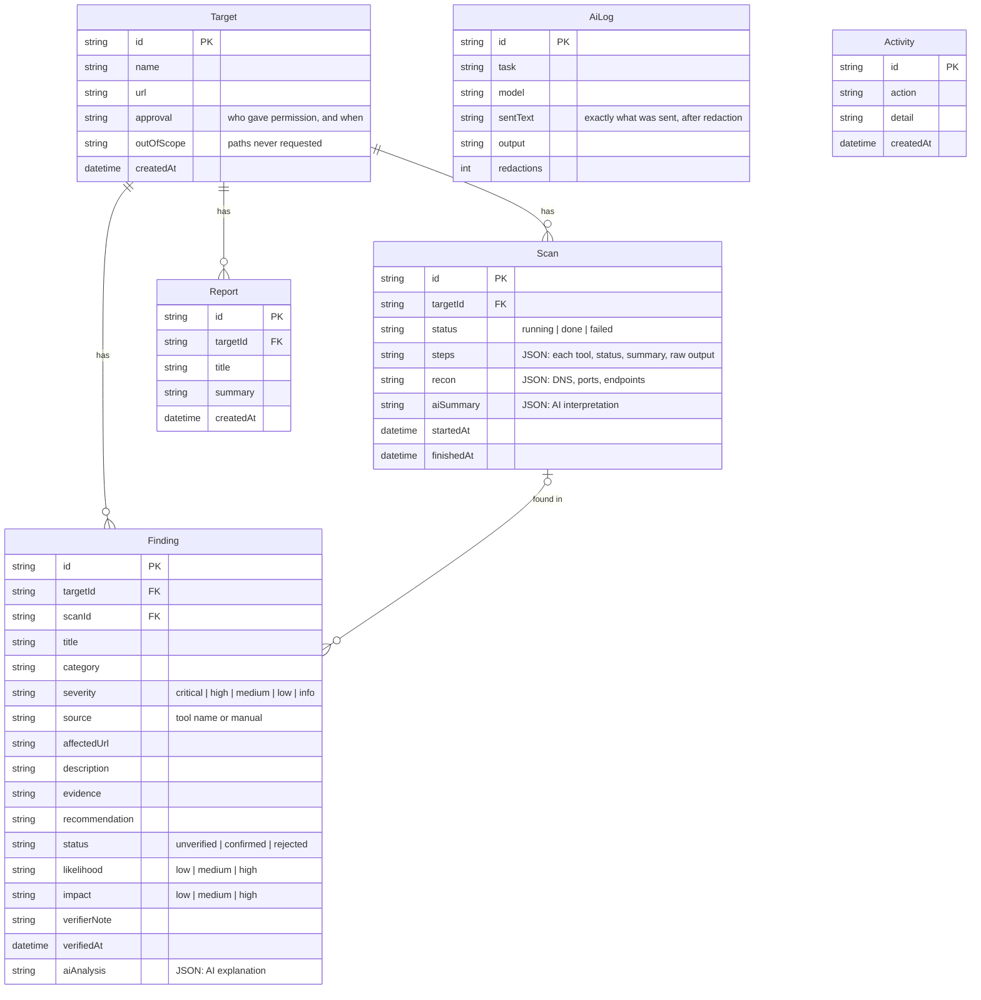
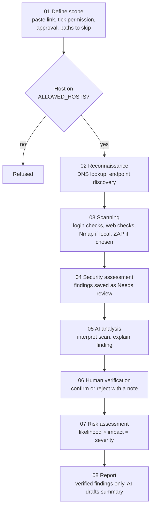

# AIVERA Lite: System Documentation

This document describes the architecture, database design, workflow and modules of AIVERA Lite.

> The diagrams are written in Mermaid. They render on GitHub and in VS Code (Markdown Preview Mermaid Support). To put them in Word or Google Docs, paste each one into https://mermaid.live and export it as PNG.

## 1. Architecture

AIVERA Lite has three layers: a React website in the browser, an Express API server, and a SQLite database. The API server runs the security tools and calls the AI service.

**Main design choices**

* **One server process.** In production the API also serves the built website, so the system runs with one command.
* **Scans run in the background.** The API answers right away, the scan saves its progress after each step, and the page asks for updates every 2 seconds.
* **Safety rules live on the server.** The allowed host list, the permission check, out-of-scope paths and the local-only rule for Nmap are enforced in the API, not only in the page.
* **AI is replaceable.** Any OpenAI-compatible chat API works, chosen in `server/.env`.

## 2. Database design

**Notes**

* A finding is unique per website by (target, title, affected URL), so scanning again does not create duplicates.
* Deleting a target deletes its scans, findings and reports.
* `AiLog` and `Activity` are the evidence trail: what was tested, when, and what was sent to the AI.

## 3. Workflow

The platform follows the 8 steps of the project brief.

**Scan steps in order**

| Step | What it does | Where it runs |
|---|---|---|
| DNS lookup | A/AAAA, CNAME, MX, TXT and NS records | All targets (skipped for IP addresses) |
| Endpoint discovery | Links on the home page, robots.txt, sitemap.xml; on the local copy also a short list of common paths compared against a "not found" baseline | All targets; common paths local only |
| Login form checks | Reads login forms: password in URL, form not on HTTPS, no anti-CSRF token. Adds a manual test checklist for every sign-in page | All targets (reads pages, never submits) |
| Web checks | Security headers, cookie flags, debug error page, TLS trust, expiry and old protocols, exposed files | All targets; exposed files local only |
| Nmap port scan | `-sT -sV --version-light -Pn --top-ports 100` | Local copy only |
| OWASP ZAP | 1 minute spider plus passive scan | Optional |

## 4. Risk rating

Likelihood and impact are each rated low (1), medium (2) or high (3) by the assessor. Their product sets the severity.

| Likelihood ↓ / Impact → | Low (1) | Medium (2) | High (3) |
|---|---|---|---|
| **High (3)** | Medium (3) | High (6) | Critical (9) |
| **Medium (2)** | Low (2) | Medium (4) | High (6) |
| **Low (1)** | Info (1) | Low (2) | Medium (3) |

## 5. Modules

| Module | File(s) | Purpose |
|---|---|---|
| Server entry | `server/src/index.ts` | Express app, Helmet headers, JSON limit, serves the built site |
| Routes | `server/src/routes.ts` | All API endpoints, input validation with Zod, risk calculation |
| Scan runner | `server/src/scanner.ts` | Runs the tools in order, saves progress and findings |
| Scope and HTTP helpers | `server/src/tools/common.ts` | Allowed host check, out-of-scope rule, safe GET (no redirects, 300 KB limit), running programs without a shell |
| DNS | `server/src/tools/dns.ts` | DNS records |
| Endpoints | `server/src/tools/endpoints.ts` | Endpoint discovery, debug tool detection |
| Login checks | `server/src/tools/loginChecks.ts` | Authentication and login security |
| Web checks | `server/src/tools/webChecks.ts` | Headers, cookies, TLS, error page, exposed files |
| Nmap | `server/src/tools/nmap.ts` | Port and service scan, XML parsing |
| ZAP | `server/src/tools/zap.ts` | ZAP automation plan and report parsing |
| AI | `server/src/ai/ai.ts`, `redact.ts` | The 3 AI features, redaction, logging |
| Website pages | `src/pages/*` | Landing and scan box, scan progress and results, findings, finding verification, dashboard, reports, activity |

## 6. API endpoints

| Method and path | Purpose |
|---|---|
| `GET /api/settings` | Allowed hosts, whether Nmap and ZAP are installed, AI model |
| `GET /api/dashboard` | Counts by status, severity and category |
| `GET, POST /api/targets` | List websites, add a website (permission required) |
| `GET, PATCH, DELETE /api/targets/:id` | Website details, edit scope, delete |
| `POST /api/targets/:id/scans` | Start a scan |
| `GET /api/scans/:id` | Scan progress and results |
| `POST /api/scans/:id/ai` | AI: interpret scan results |
| `GET, POST /api/findings` | List findings, add one by hand |
| `GET /api/findings/:id` | Finding details |
| `POST /api/findings/:id/verify` | Confirm, reject or reopen |
| `POST /api/findings/:id/ai` | AI: explain the finding |
| `GET, POST /api/reports`, `GET, PATCH, DELETE /api/reports/:id` | Reports |
| `POST /api/reports/:id/ai-summary` | AI: draft the summary |
| `GET /api/activity` | Activity log and AI requests |

## 7. Security of the platform itself

* Only hosts listed in `ALLOWED_HOSTS` can be scanned; the check runs when a website is added and again before every scan.
* Links with a user name or password are refused.
* Tools are started without a shell, so a link cannot inject commands.
* Requests do not follow redirects, so a scan cannot be redirected to another host.
* Response bodies are capped at 300 KB.
* Secrets, cookies, tokens, keys and email addresses are removed before text is sent to the AI.
* API keys are kept in `server/.env` and never sent to the browser.
* The platform has no sign-in, so it must not be published on the internet as it is. It is meant to run on the tester's computer.

## 8. Installation

See `README.md`. In short: `npm install`, copy `server/.env.example` to `server/.env`, `npm run db:setup`, then `npm run dev` and open http://localhost:5190.
